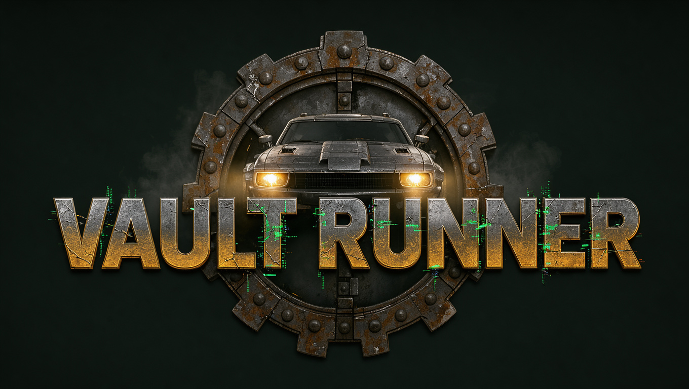

  

# VAULT RUNNER

2.5D-экшен с видом сверху в сеттинге ночного постапокалиптического кибер-мегаполиса: руины, радиационные кратеры, крышки, Бункер-Депо, ретро-терминал V-CORE, открытый город с перестрелками, контрактами, прогрессивными врагами (`MK-I..MK-V`) и режимом **Цифрового Фокуса** (замедление времени).

Проект полностью статический — работает на **GitHub Pages** без бэкенда, адаптирован под **монитор ПК** и **смартфон (портрет / альбом)**, а также упаковывается в автономное **Android-приложение (`.apk` / `.aab`)** для **RuStore** из единого исходного кода.

- 👉 **Играть онлайн:** https://dmirii.github.io/Gta0/
- 🔒 **Политика конфиденциальности:** https://dmirii.github.io/Gta0/privacy.html
- 📱 **Сборка Android APK и публикация в RuStore:** см. [`android/RUSTORE_RELEASE.md`](android/RUSTORE_RELEASE.md)

## Особенности и интерфейс

- **2.5D ночной кибер-нуар мегаполис**: объёмные руины зданий в перспективе сверху, динамические конусы фар и фонарей, костры, светофоры, лужи, зоны радиации и цифровые разломы.
- **Монитор ПК (`>= 900px`)**: ретро-монитор V-CORE с аппаратными индикаторами (`PWR` / `RAD` / `CODE`), сегментными шкалами и боковым меню **VAULT RUNNER // 2077**: тактический радар с легендой лута, анимированная камера в кабине водителя **CABIN CAM** (повороты головы, моргание, отблески стрельбы, глоток из фляжки, бегущий цифровой код в очках и живая ЭКГ), статус, гараж с фото машины и иконками апгрейдов, контракты и настройки.
- **Гараж, 5 классов авто и визуальная эволюция**: `SCOUT BUGGY` → `RUST INTERCEPTOR` → `VAULT ENFORCER` → 6-колёсный `WAR RIG MK-IV` → `CYBER PHANTOM`. Все апгрейды (сдвоенный пулемёт и три-плазма, самонаводящиеся ракеты, боковые бронеборта и шипастый таран, нагнетатель V8 / нитро, Ядро Перегрузки) визуально отображаются прямо на машине и сбалансированы против 4 архетипов врагов (`MK-I..MK-V`), включая элитного **Карателя Системы**.
- **Процедурный Web Audio звук**: 4-канальный чиптюн-трекер в стиле Keygen (с замедлением и фильтрацией в Цифровом Фокусе), динамический синтез двигателя с 4-ступенчатой КПП, дрифтом и нитро, и многослойные SFX.
- **Автосохранение прогресса**: класс машины, апгрейды, крышки и рекорды автоматически сохраняются локально в `localStorage` (без сервера и без сбора персональных данных).
- **Телефон и Android (`< 900px`)**: адаптивный полноэкранный интерфейс, сенсорный аналоговый джойстик, кнопки **ОГОНЬ** (с автонаводкой) и **⚡ ФОКУС**, виброотклик, плавающий радар, автопауза при сворачивании и системная кнопка «Назад».

## Управление

### ПК / Монитор
- **W / A / S / D** или **стрелки** (работает и в русской раскладке) — вождение
- **Мышь + ЛКМ** или **Пробел** — стрельба из турели
- **Shift** или **ПКМ** — замедление времени (**Цифровой Фокус**)
- **E** — ремонт и снятие радиации в Бункере-Депо
- **M** — вкл/выкл фоновой Keygen-музыки
- **1–4** — переключение вкладок меню · **Esc / P** — пауза

### Телефон / Android
- Левый виртуальный стик — руль и газ
- **ОГОНЬ** — стрельба с автонаводкой на ближайшего врага
- **⚡ ФОКУС** — включение/выключение режима замедления времени
- **☰ МЕНЮ** — открытие терминала (гараж, карта, миссии, настройки)

## Структура проекта

- `index.html`, `privacy.html`, `favicon.svg` — игра, политика конфиденциальности и фавикон
- `css/style.css` — адаптивные стили терминала V-CORE для монитора и смартфона
- `js/audio.js` — процедурный Web Audio движок (Keygen-чиптюн, синтез двигателя, SFX, suspend/resume)
- `js/world.js` — генератор 2.5D-города, запечённая карта, коллизии, Бункер-Депо, зоны радиации и терминалы
- `js/game.js` — игровой цикл, физика авто, 2.5D-рендер, ИИ врагов `MK-I..MK-V`, миссии, гараж и нативный мост Android
- `assets/logo.png`, `assets/icon-512.png`, `assets/driver-sheet.jpg`, `assets/cars/car-0..4.jpg` — графика и иконка для RuStore
- `android/` — автономная Android-оболочка (`ru.dimaa.vaultrunner`, `WebViewAssetLoader`), автоматически подтягивающая файлы игры из корня
- `.github/workflows/android-apk.yml` — автосборка подписанного `.apk` / `.aab` (или тестового debug `.apk`) на GitHub Actions

## Об авторах

**VAULT RUNNER** создан в живом дуэте человека и AI-агента:

- **Дмитрий Антонов (`@Dmirii`)** — автор идеи, геймдизайн, продюсирование и итеративное развитие проекта. Инженер-программист по образованию (ГУАП), вернулся к истокам — создаёт веб-игры и AI-проекты.
  - Сайт: [dimaa.ru](https://dimaa.ru/)
  - Telegram: [@Dimaa_ru](https://t.me/Dimaa_ru)
  - GitHub: [github.com/Dmirii](https://github.com/Dmirii)
  - Email: [dimaa@dimaa.ru](mailto:dimaa@dimaa.ru)
  - ВКонтакте: [@dimaa_ru](https://vk.com/dimaa_ru)
- **Arena.ai · Agent Mode** ([arena.ai](https://arena.ai)) — соавтор и AI-разработчик: архитектура HTML5 Canvas 2D, 2.5D-город, физика и баланс врагов, процедурный Keygen-чиптюн и синтез мотора, графика гаража, `CABIN CAM` и Android-оболочка для RuStore.
